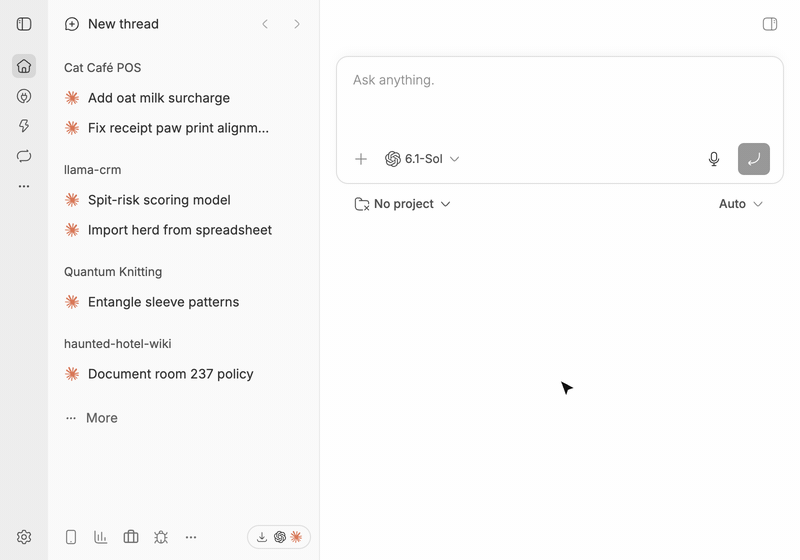
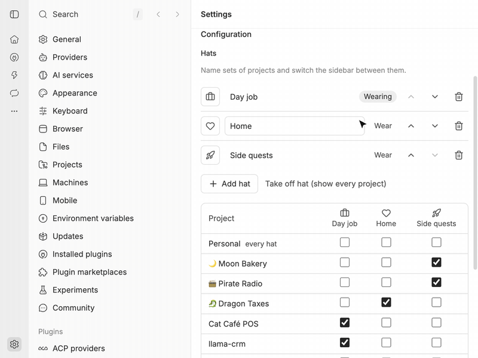

# bb-plugin-hats

**We all wear many hats. bb should know which one you've got on.**

Hats adds workspaces to the bb sidebar. A hat is a group of projects, like
Work or Personal. Click the button in the sidebar footer to switch to the
next hat, and the projects that belong to your other hats are hidden.



Hats preserves normal project ordering by hiding and showing projects in the
bb thread list, preserving ordering.

## Setting up hats



On the settings page you can add, rename, reorder and delete hats, pick an
icon for each, and choose which projects are included in each one. A project
can be in more than one hat. A project that is in no hat is always visible, so
new projects show up until you file them somewhere.

A new install starts with two empty hats, Work and Personal. Nothing is hidden
until you put projects in them.

## CLI

Everything on the settings page is also available from the terminal, which
means agents can switch hats too:

```
bb hats status | wear | next | create | rename | icon | delete | add | remove | icons
```

## How it works

Hats edits one sidebar setting: bb's list of hidden projects (the thread
list's `hiddenGroups` preference). Switching to a hat hides the projects that are
in other hats but not in that one. Each switch replaces the `project:` entries
in the list and leaves the rest alone, including any sections or machines you
hid yourself. bb keeps a hidden project's place in the sidebar, which is why
switching never shuffles your layout.

The footer button cycles through hats in the order they have on the settings
page. Hats are saved in the plugin's own storage and survive restarts.
